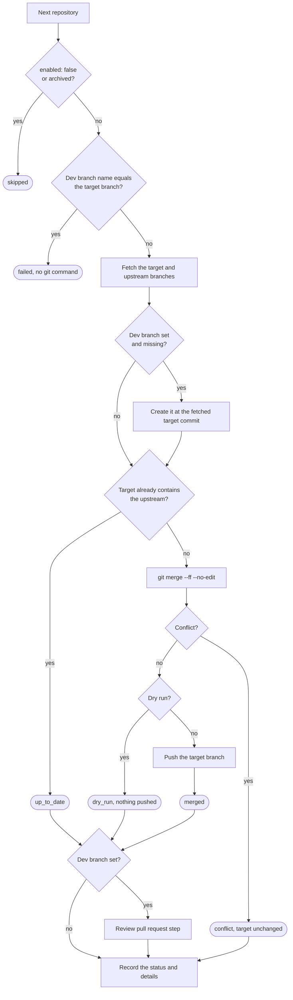

# Fork Sync Manager

English | [简体中文](README.zh-CN.md)

Keep every fork in your GitHub account up to date from one repository. A scheduled GitHub Actions workflow finds your forks, merges each fork's upstream into it, and pushes the result. It can also open a pull request from the synced branch into a development branch, so upstream changes reach that branch only after someone reviews them.

## Contents

- [Features](#features)
- [How it works](#how-it-works)
- [Quick start](#quick-start)
- [Configuration](#configuration)
- [Review pull requests](#review-pull-requests)
- [Run results](#run-results)
- [Resolve a merge conflict](#resolve-a-merge-conflict)
- [Safety notes](#safety-notes)
- [Local verification](#local-verification)
- [License](#license)

## Features

- Finds your forks automatically. You do not list them or type their upstream addresses.
- Merges with a normal `git merge`, so your own commits stay in history. A fork with no commits of its own is fast-forwarded.
- Pushes without force. A merge conflict leaves the fork unchanged and fails the run, so you can resolve it by hand.
- Optionally opens a review pull request from the synced branch into one development branch.
- Takes per-fork overrides (upstream, branches, pause) from a GitHub Actions variable.
- Supports a dry run, writes a per-repository summary on every run, and fails the workflow when a repository needs attention.

## How it works

The workflow `.github/workflows/daily-sync.yml` runs `python scripts/sync.py` every day at 03:17 UTC. You can also start it from **Actions → Daily Upstream Sync → Run workflow**. Only one run executes at a time. GitHub can start scheduled runs late when Actions is busy.

### One run

1. The script checks `FORK_SYNC_TOKEN`, `FORK_SYNC_DEV_BRANCH`, `FORK_SYNC_REPOS`, and `config/repos.yml`. Any problem ends the run with exit code `2` before the first GitHub API call.
2. It selects the repositories: the discovered forks plus the entries in `FORK_SYNC_REPOS`, minus `exclude`. If more than `max_repos` remain, or none, the run ends with exit code `2`. If listing the forks fails, the run ends with exit code `1`.
3. It processes the repositories one at a time. An error in one repository marks that repository `failed`, and the others continue.
4. It writes a summary with every repository's status and details. The exit code is `1` when any repository is `failed` or `conflict`, and `0` otherwise.

### Each repository

Each repository is processed in its own temporary directory:

1. A repository with `enabled: false`, or an archived repository, is `skipped`.
2. The script reads the fork and upstream metadata and resolves the upstream, the target branch, the upstream branch, and the dev branch. If the dev branch has the same name as the target branch, the repository is `failed` before any git command runs.
3. It fetches the target branch and the upstream branch.
4. If a dev branch is set and the fork does not have it yet, the script creates it at the target commit fetched in step 3. This happens before the target branch is pushed. If a run stops right after the push, the next run still cannot start the dev branch from unreviewed upstream commits. A dry run does not create the branch.
5. If the target branch already contains the upstream branch, the repository is `up_to_date`. Otherwise the script runs `git merge --ff --no-edit`:
   - A fork with no commits of its own is fast-forwarded. Otherwise Git creates a merge commit.
   - On a conflict, the script aborts the merge and marks the repository `conflict`. The target branch keeps its commit and step 6 is skipped.
   - In a dry run, nothing is pushed and the repository is `dry_run`.
   - Otherwise the script pushes the target branch and marks the repository `merged`.
6. If a dev branch is set, the script handles the review pull request. See [Review pull requests](#review-pull-requests).



## Quick start

1. Create a repository for the manager, for example `fork-sync-manager`, and put these files at the root of its default branch. GitHub runs scheduled workflows only from the default branch.
2. Copy the files rather than forking this repository. A fork of this repository is discovered like any other fork when your token can see it, and the script then merges this repository into it. If you do fork it, leave that fork out of the token's repository access or add it to `exclude`.
3. Create a [fine-grained personal access token](https://github.com/settings/personal-access-tokens/new):
   - **Resource owner:** your account.
   - **Repository access:** the forks you want to sync. Start with one or two.
   - **Repository permissions:** see the table below.
4. In the manager repository, open **Settings → Secrets and variables → Actions** and add the secret `FORK_SYNC_TOKEN` with the token as its value. Do not put the token in any file.
5. Optionally add the variables `FORK_SYNC_DEV_BRANCH` and `FORK_SYNC_REPOS` on the **Variables** tab. See [Secrets and variables](#secrets-and-variables). Use Variables rather than Secrets for these two. Actions prints secret values as `***` in logs, which would hide the branch and repository names in every status line.
6. Replace `config/repos.yml` with `config/repos.example.yml`, which starts with `dry_run: true`. Commit, and start the workflow by hand. Check the selected forks, upstreams, and branches in the run summary. A dry run still merges in a temporary directory, so a fork with conflicts shows up as `conflict` and the run fails.
7. Set `dry_run: false`, commit, and start the workflow once more. From then on it runs every day.

| Token permission | Access | Why the script needs it |
|---|---|---|
| Contents | Read and write | Fetch and push branches, and create the dev branch. |
| Workflows | Read and write | Push upstream commits that add or change files under `.github/workflows/`. GitHub rejects those pushes without it. |
| Pull requests | Read and write | Open review pull requests. Needed only when `FORK_SYNC_DEV_BRANCH` is set. |
| Metadata | Read-only | Required by GitHub for every fine-grained token. |

If an upstream is private and belongs to another account, the token also needs read access to it. An upstream that belongs to another organization may require a GitHub App instead of a personal access token.

## Configuration

Settings that apply to every run live in `config/repos.yml`. The token and the per-fork entries live in GitHub Actions secrets and variables.

The `config/repos.yml` in this repository is the live configuration of the author's own manager, so it has `dry_run: false`. Start from `config/repos.example.yml` instead.

### config/repos.yml

The file contains only the `settings` key. Any other top-level key, including `repos`, ends the run with exit code `2`.

```yaml
settings:
  dry_run: true
  discover_forks: true
  max_repos: 100
  exclude: []
```

| Key | Default | Description |
|---|---|---|
| `dry_run` | `false` | `true` merges in a temporary directory without pushing, creating branches, or calling the pull request API. Write `true` or `false`, not a string. |
| `discover_forks` | `true` | Lists the repositories the token can see with `GET /user/repos?affiliation=owner` and keeps the forks that belong to `owner`. |
| `max_repos` | `100` | Upper limit on the repositories left after `exclude`. An integer from 1 to 1000. It stops a run when the token sees more repositories than you expect. |
| `exclude` | `[]` | Repositories to skip, as a name (`widget`) or as `owner/repo`. |
| `owner` | owner of the manager repository | The account whose forks are synced. |

To sync only some forks, list the others in `exclude`, or grant the token access to only those forks.

### Secrets and variables

| Name | Kind | Required | Value |
|---|---|---|---|
| `FORK_SYNC_TOKEN` | Secret | Yes | The fine-grained personal access token. |
| `FORK_SYNC_DEV_BRANCH` | Variable | No | The dev branch name, the same for every fork. Unset or blank means no review pull requests. |
| `FORK_SYNC_REPOS` | Variable | No | A YAML list of per-fork entries. A JSON list also works. Unset or blank means no entries. |

Edits to variables do not appear in git history. A value the script cannot use ends the next run with exit code `2`.

### FORK_SYNC_REPOS

Each entry overrides one fork. GitHub variables can hold several lines, so you can paste the list as written here:

```yaml
- fork: YOUR_NAME/special-fork
  upstream: SOURCE_OWNER/special-upstream
  target_branch: main
  upstream_branch: develop
- fork: YOUR_NAME/paused-fork
  enabled: false
```

| Key | Default | Description |
|---|---|---|
| `fork` | (required) | `owner/repo`. The owner must be `settings.owner`. |
| `enabled` | `true` | `false` marks the fork `skipped` without any GitHub API call. |
| `upstream` | the fork's parent | `owner/repo` to merge from. Required for a repository that is not a GitHub fork. |
| `target_branch` | the fork's default branch | Branch in the fork that receives the merge. It must already exist. |
| `upstream_branch` | the upstream's default branch | Branch in the upstream to merge from. |

A fork has one target branch. After you set `target_branch`, the fork's default branch is no longer synced.

You can also add a repository that is not a GitHub fork, such as a mirror. It must belong to `settings.owner` and needs an `upstream` entry.

### What fails validation

These problems end the run with exit code `2` before any repository is processed:

- a missing `FORK_SYNC_TOKEN`
- an unknown key, such as `dryrun` or `upstream_brnach`
- a string where `true` or `false` is expected, such as `"false"`
- an invalid branch name, including `FORK_SYNC_DEV_BRANCH`
- a `fork` that does not belong to `owner`
- `FORK_SYNC_REPOS` that is not valid YAML or is not a list
- a top-level key other than `settings` in `config/repos.yml`
- more than `max_repos` repositories after `exclude`, or no repository at all

## Review pull requests

Set `FORK_SYNC_DEV_BRANCH` to keep auto-merged upstream code out of your development branch until someone reviews it. The target branch keeps receiving upstream merges. The dev branch receives them only through a pull request from the target branch.

- If a fork does not have the dev branch, the script creates it at the target commit fetched before this run's merge. After that the script never pushes to the dev branch. New commits reach it through the review pull request or through your own pushes.
- If the dev branch already contains the target branch, nothing happens.
- If a review pull request is open, the script reuses it. Its head is the target branch itself, so it picks up new target commits without any change by the script.
- If the newest closed review pull request still points at the current target commit, the script does not open another one. It opens a new pull request after the target branch moves. A squash-merged pull request counts as closed.
- Otherwise the script opens a pull request titled `Upstream sync: merge <target branch> into <dev branch>`.
- If this step fails, the repository is `failed`. When the target branch was pushed in the same run, the details say so. The next run checks again and opens the pull request.

Merge review pull requests with **Create a merge commit**. A squash merge makes the next pull request list the same commits again.

To require a review before merging, add a branch protection rule to the dev branch. GitHub does not let a pull request's author approve it, and these pull requests are authored by the token's owner. A required approval therefore needs another developer or an administrator bypass.

If a fork's target branch has the same name as `FORK_SYNC_DEV_BRANCH`, that fork is `failed` with `FORK_SYNC_DEV_BRANCH '<name>' is the target branch of <fork>; set target_branch for this repo or exclude it`. Set `target_branch` for it in `FORK_SYNC_REPOS`, or add it to `exclude`.

A conflict between the target branch and the dev branch appears in the pull request, not as a `conflict` status. Resolve it with GitHub's conflict editor, or merge the target branch into the dev branch locally and push.

## Run results

Each run's summary is on its page under **Actions → Daily Upstream Sync**.

| Status | Meaning |
|---|---|
| `merged` | The merge result was pushed to the target branch. `fast-forward` in the details means a fast-forward. `merge commit` means the fork has its own commits. |
| `up_to_date` | The target branch already contains the upstream branch. |
| `conflict` | The merge conflicted. The details list the files and say which branches to merge by hand. The target branch is unchanged. Fails the workflow. |
| `skipped` | The repository is archived or has `enabled: false`. |
| `failed` | Missing permission, a network or API error, a missing repository or upstream, unrelated histories, a dev branch named like the target branch, a failed review pull request, or a rejected push. Fails the workflow. |
| `dry_run` | The merge ran in a temporary directory and nothing was pushed. The details say what would be pushed. A conflict in a dry run is still `conflict`. |

A push is usually rejected for one of three reasons: a branch protection rule, a token without the Workflows permission, or a commit someone else pushed to the target branch during the run. The next run merges again on top of the new target branch.

With a dev branch set, the details continue after `; ` with what happened to the dev branch. With target branch `main` and dev branch `develop`:

| Detail | Meaning |
|---|---|
| `created develop at abcdefabcdef` | The dev branch was created in this run. |
| `opened PR #1 from main into develop: <link>` | A review pull request was opened in this run. |
| `PR #1 from main into develop is open: <link>` | The open review pull request was reused. |
| `develop already contains main` | No pull request is needed. |
| `PR #1 was closed at abcdefabcdef; a new PR opens after main moves` | The newest review pull request is closed and the target branch has not moved since. |
| `would create develop at ...`, `would open a PR from main into develop` | A dry run reports what it would do. |

A complete detail line looks like `pushed fast-forward 0123456789ab to main; created develop at abcdefabcdef; opened PR #1 from main into develop: https://github.com/YOUR_NAME/REPO/pull/1`.

| Exit code | Meaning |
|---|---|
| `0` | No repository is `failed` or `conflict`. |
| `1` | At least one repository is `failed` or `conflict`, or listing the forks failed. |
| `2` | `FORK_SYNC_TOKEN` is missing, or the configuration is invalid. |

## Resolve a merge conflict

A `conflict` detail ends with `Merge SOURCE_OWNER/REPO@main into main by hand`, which names the upstream, the upstream branch, and the target branch. Merge locally and push. With `main` on both sides:

```shell
git clone https://github.com/YOUR_NAME/REPO.git
cd REPO
git remote add upstream https://github.com/SOURCE_OWNER/REPO.git
git fetch upstream
git merge upstream/main
```

Fix the conflicting files as Git describes, then commit and push:

```shell
git add .
git commit --no-edit
git push origin main
```

The next run reports `up_to_date`, or `merged` if the upstream moved again and merges cleanly. To pause a fork until you get to it, add `enabled: false` for it in `FORK_SYNC_REPOS`.

## Safety notes

- The push command is `git push origin HEAD:refs/heads/<target branch>`, without force. Git rejects it when the remote branch moved during the run.
- If a fork has Actions enabled and a workflow whose `on: push` covers the target branch, the script's push starts that workflow, for example a deployment.
- A clean merge means Git combined the text. It does not mean the result builds or runs. Run CI on your forks to catch that.
- Unrelated histories cannot be merged and mark the repository `failed`. Check that `upstream` points at the right repository.
- Each repository fetches the full history of two branches, one repository after another. With many or large repositories, watch the workflow's 90-minute timeout and GitHub API rate limits.
- Fine-grained tokens expire. Update the `FORK_SYNC_TOKEN` secret when yours does.

## Local verification

The script needs Python 3.12, PyYAML (`requirements.txt`), and Git. The GitHub Actions runner provides Git.

`.cursor/skills/verify-fork-sync/` holds a local harness. It runs the real `scripts/sync.py` against local bare repositories and a stand-in for the GitHub API, then records every status line, branch change, pull request, and API request. Its `pin.py` replays 24 fixed scenarios, including merges, fast-forwards, conflicts, dry runs, review pull requests, and configuration errors. Compare two records to see exactly what a change altered. The harness has been run on Windows with PowerShell 5.1:

```powershell
python -m venv .venv
.\.venv\Scripts\python.exe -m pip install -r requirements.txt
.\.venv\Scripts\python.exe .cursor\skills\verify-fork-sync\scripts\pin.py --out .verify\pin\before.txt
.\.venv\Scripts\python.exe .cursor\skills\verify-fork-sync\scripts\pin.py --out .verify\pin\after.txt
.\.venv\Scripts\python.exe .cursor\skills\verify-fork-sync\scripts\pin.py --compare .verify\pin\before.txt .verify\pin\after.txt
```

See `.cursor/skills/verify-fork-sync/SKILL.md` for driving single scenarios by hand and for what the stand-in does not cover.

## License

MIT. See [LICENSE](LICENSE).
