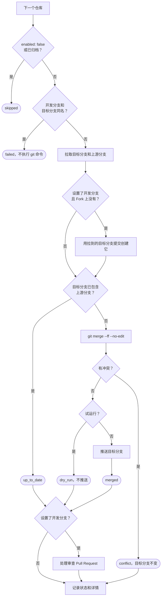

# Fork Sync Manager

[English](README.md) | 简体中文

用一个仓库让你 GitHub 账号下的所有 Fork 跟上上游。GitHub Actions 每天定时运行，找出你的 Fork，把每个 Fork 的上游合并进去，再把结果推上去。你还可以让它从同步后的分支向开发分支开一个 Pull Request，上游的改动要经过审查才进入开发分支。

## 目录

- [功能](#功能)
- [运行流程](#运行流程)
- [快速开始](#快速开始)
- [配置](#配置)
- [审查 Pull Request](#审查-pull-request)
- [运行结果](#运行结果)
- [处理合并冲突](#处理合并冲突)
- [安全说明](#安全说明)
- [本地验证](#本地验证)

## 功能

- 自动发现你的 Fork，不用逐个列出，也不用填写上游地址。
- 用普通 `git merge` 合并，你自己的提交留在历史里。Fork 没有自己的提交时直接快进。
- 推送不带 force。合并有冲突时 Fork 保持不变，本次运行失败，由你手工处理。
- 可以从同步后的分支向一个开发分支开审查 Pull Request。
- 单个 Fork 的覆盖项（上游、分支、暂停）写在 GitHub Actions 变量里。
- 支持试运行。每次运行都给出每个仓库的摘要，有仓库需要处理时 workflow 会失败。

## 运行流程

workflow `.github/workflows/daily-sync.yml` 每天 03:17 UTC 执行一次 `python scripts/sync.py`，也可以在 **Actions → Daily Upstream Sync → Run workflow** 手动执行。同一时间只会有一次运行。Actions 负载高时，GitHub 可能推迟定时任务的开始时间。

### 一次运行

1. 检查 `FORK_SYNC_TOKEN`、`FORK_SYNC_DEV_BRANCH`、`FORK_SYNC_REPOS` 和 `config/repos.yml`。有任何问题时以退出码 `2` 结束，不调用 GitHub API。
2. 选出要处理的仓库：自动发现的 Fork 加上 `FORK_SYNC_REPOS` 里的项，去掉 `exclude`。剩下的数量超过 `max_repos` 或者为零时，以退出码 `2` 结束。列出 Fork 时出错，以退出码 `1` 结束。
3. 逐个处理仓库。一个仓库出错只把它记为 `failed`，其他仓库照常处理。
4. 写出摘要，列出每个仓库的状态和详情。有仓库记为 `failed` 或 `conflict` 时退出码为 `1`，否则为 `0`。

### 每个仓库

每个仓库在自己的临时目录里处理：

1. 写了 `enabled: false` 或者已归档的仓库记为 `skipped`。
2. 读取 Fork 和上游的仓库信息，确定上游、目标分支、上游分支和开发分支。开发分支和目标分支同名时，该仓库记为 `failed`，不执行任何 git 命令。
3. 拉取目标分支和上游分支。
4. 设置了开发分支、而 Fork 上还没有这个分支时，用第 3 步拉到的目标分支提交创建它。这一步在推送目标分支之前进行。即使运行在推送之后中断，下一次运行也不会从含有未审查上游提交的目标分支创建开发分支。试运行不创建。
5. 目标分支已经包含上游分支时，记为 `up_to_date`。否则执行 `git merge --ff --no-edit`：
   - Fork 没有自己的提交时走快进，否则生成合并提交。
   - 有冲突时中止合并，记为 `conflict`。目标分支保持原提交，跳过第 6 步。
   - 试运行不推送，记为 `dry_run`。
   - 其余情况推送目标分支，记为 `merged`。
6. 设置了开发分支时，处理审查 Pull Request，见[审查 Pull Request](#审查-pull-request)。



## 快速开始

1. 新建一个管理仓库，例如 `fork-sync-manager`，把这些文件放在它默认分支的根目录。GitHub 只运行默认分支里的定时 workflow。
2. 复制文件，不要 Fork 本仓库。如果 Token 能看到你 Fork 出来的这个仓库，脚本会把它当作普通 Fork，把本仓库合并进去。确实要 Fork 的话，不要把这个 Fork 加进 Token 的仓库访问范围，或者把它写进 `exclude`。
3. 创建 [fine-grained personal access token](https://github.com/settings/personal-access-tokens/new)：
   - **Resource owner**：你的账号。
   - **Repository access**：要同步的 Fork。先选一两个试一试。
   - **Repository permissions**：见下表。
4. 在管理仓库打开 **Settings → Secrets and variables → Actions**，新建 Secret `FORK_SYNC_TOKEN`，值填这个 Token。不要把 Token 写进任何文件。
5. 按需在 **Variables** 页新建变量 `FORK_SYNC_DEV_BRANCH` 和 `FORK_SYNC_REPOS`，见[Secret 和变量](#secret-和变量)。这两个用 Variables，不要用 Secrets。Actions 会把 Secret 的值在日志里显示成 `***`，每条状态里的分支名和仓库名都会被遮住。
6. 在 `config/repos.yml` 里设置 `dry_run: true`，提交后手动运行一次。在运行摘要里检查选中的 Fork、上游和分支。试运行也会在临时目录里真实合并一次，有冲突的 Fork 会记为 `conflict`，这次运行会失败。
7. 改成 `dry_run: false`，提交后再手动运行一次。之后每天自动运行。

| Token 权限 | 级别 | 用途 |
|---|---|---|
| Contents | Read and write | 拉取和推送分支，创建开发分支。 |
| Workflows | Read and write | 推送新增或修改了 `.github/workflows/` 下文件的上游提交。没有这个权限时 GitHub 会拒绝推送。 |
| Pull requests | Read and write | 开审查 Pull Request。只有设置了 `FORK_SYNC_DEV_BRANCH` 时才需要。 |
| Metadata | Read-only | GitHub 对每个 fine-grained token 都要求这一项。 |

上游是私有仓库、而且属于别的账号时，Token 还需要能读到它。属于别的组织的上游，可能需要改用 GitHub App 而不是个人 Token。

## 配置

每次运行都适用的设置写在 `config/repos.yml`。Token 和单个 Fork 的覆盖项写在 GitHub Actions 的 Secret 和变量里。

### config/repos.yml

文件里只能有 `settings` 一个顶层键。出现其他顶层键（包括 `repos`）时，运行以退出码 `2` 结束。

```yaml
settings:
  dry_run: true
  discover_forks: true
  max_repos: 100
  exclude: []
```

| 键 | 默认值 | 说明 |
|---|---|---|
| `dry_run` | `false` | `true` 时只在临时目录里合并，不推送、不建分支、不调用 Pull Request 接口。必须写 `true` 或 `false`，不能写成字符串。 |
| `discover_forks` | `true` | 用 `GET /user/repos?affiliation=owner` 列出 Token 能看到的仓库，留下属于 `owner` 的 Fork。 |
| `max_repos` | `100` | 去掉 `exclude` 之后最多处理的仓库数，1 到 1000 的整数。Token 能看到的仓库比预期多时，运行会停下来。 |
| `exclude` | `[]` | 要跳过的仓库，可以只写仓库名（`widget`），也可以写 `owner/repo`。 |
| `owner` | 管理仓库的所有者 | 要同步哪个账号的 Fork。 |

只想同步部分 Fork 时，把其他的写进 `exclude`，或者只给 Token 授权这些 Fork。

### Secret 和变量

| 名称 | 类型 | 必填 | 值 |
|---|---|---|---|
| `FORK_SYNC_TOKEN` | Secret | 是 | fine-grained personal access token。 |
| `FORK_SYNC_DEV_BRANCH` | Variable | 否 | 开发分支名，所有 Fork 共用。不设置或留空时不开审查 Pull Request。 |
| `FORK_SYNC_REPOS` | Variable | 否 | 单个 Fork 覆盖项的 YAML 列表，也可以写 JSON 列表。不设置或留空时没有覆盖项。 |

修改变量不会留在 git 历史里。脚本用不了的值会让下一次运行以退出码 `2` 结束。

### FORK_SYNC_REPOS

每一项覆盖一个 Fork。GitHub 变量可以填多行文本，下面的列表可以原样粘贴进去：

```yaml
- fork: YOUR_NAME/special-fork
  upstream: SOURCE_OWNER/special-upstream
  target_branch: main
  upstream_branch: develop
- fork: YOUR_NAME/paused-fork
  enabled: false
```

| 键 | 默认值 | 说明 |
|---|---|---|
| `fork` | （必填） | `owner/repo`，所有者必须是 `settings.owner`。 |
| `enabled` | `true` | `false` 时记为 `skipped`，不调用 GitHub API。 |
| `upstream` | Fork 的 parent | 合并来源 `owner/repo`。不是 GitHub Fork 的仓库必须写。 |
| `target_branch` | Fork 的默认分支 | Fork 里接收合并的分支，必须已经存在。 |
| `upstream_branch` | 上游的默认分支 | 上游里作为合并来源的分支。 |

一个 Fork 只有一个目标分支。写了 `target_branch` 之后，Fork 的默认分支就不再同步。

也可以加入不是 GitHub Fork 的仓库，例如镜像仓库。它必须属于 `settings.owner`，并且要写 `upstream`。

### 校验失败的情况

下面这些问题会让运行以退出码 `2` 结束，一个仓库都不处理：

- 缺少 `FORK_SYNC_TOKEN`
- 未知的键，例如 `dryrun`、`upstream_brnach`
- 应该写 `true` 或 `false` 的地方写成了字符串，例如 `"false"`
- 不合法的分支名，包括 `FORK_SYNC_DEV_BRANCH`
- 不属于 `owner` 的 `fork`
- `FORK_SYNC_REPOS` 不是合法的 YAML，或者不是列表
- `config/repos.yml` 里有 `settings` 以外的顶层键
- 去掉 `exclude` 之后超过 `max_repos`，或者一个仓库都没有

## 审查 Pull Request

设置 `FORK_SYNC_DEV_BRANCH` 后，自动合并进来的上游代码要经过审查才进入开发分支。目标分支照常接收上游合并，开发分支只通过从目标分支发起的 Pull Request 接收这些改动。

- Fork 上没有开发分支时，脚本用本次合并前拉到的目标分支提交创建它。之后脚本不再向开发分支推送。开发分支上的新提交来自审查 Pull Request，或者来自你自己的推送。
- 开发分支已经包含目标分支时，什么都不做。
- 已有打开的审查 Pull Request 时直接复用。它的来源分支就是目标分支，目标分支有新提交时会自动带上，脚本不用改它。
- 最近一个关闭的审查 Pull Request 还停在目标分支当前的提交上时，不开新的。目标分支有新提交之后才再开一个。用 squash 合并的 Pull Request 也按关闭处理。
- 其他情况新开一个 Pull Request，标题是 `Upstream sync: merge <目标分支> into <开发分支>`。
- 这一步出错时，该仓库记为 `failed`。如果本次已经推送了目标分支，详情里会写明。下一次运行会重新检查并补开 Pull Request。

合并审查 Pull Request 时选择 **Create a merge commit**。Squash 合并会让下一次 Pull Request 再次列出同样的提交。

要求先审查再合并时，给开发分支加上保护规则。GitHub 不允许 Pull Request 的作者批准自己的 Pull Request，而这些 Pull Request 的作者是 Token 的所有者。所以要求批准时，需要另一位开发者，或者由管理员绕过。

某个 Fork 的目标分支和 `FORK_SYNC_DEV_BRANCH` 同名时，该仓库记为 `failed`，详情是 `FORK_SYNC_DEV_BRANCH '<名字>' is the target branch of <fork>; set target_branch for this repo or exclude it`。在 `FORK_SYNC_REPOS` 里给它写 `target_branch`，或者把它写进 `exclude`。

目标分支和开发分支之间的冲突出现在 Pull Request 上，不记为 `conflict`。可以用 GitHub 的冲突编辑器解决，也可以在本地把目标分支合并进开发分支再推送。

## 运行结果

每次运行的摘要在 **Actions → Daily Upstream Sync** 对应的运行页面上。

| 状态 | 含义 |
|---|---|
| `merged` | 合并结果已推到目标分支。详情里的 `fast-forward` 表示快进，`merge commit` 表示 Fork 有自己的提交。 |
| `up_to_date` | 目标分支已经包含上游分支。 |
| `conflict` | 合并有冲突。详情列出冲突文件，并写明要手工合并哪两个分支。目标分支不变。会让 workflow 失败。 |
| `skipped` | 仓库已归档，或者写了 `enabled: false`。 |
| `failed` | 权限不足、网络或 API 错误、仓库或上游不存在、两边历史不相关、开发分支和目标分支同名、审查 Pull Request 出错，或者推送被拒。会让 workflow 失败。 |
| `dry_run` | 在临时目录里完成合并，没有推送。详情写明会推送什么。试运行遇到冲突时仍记为 `conflict`。 |

推送被拒通常有三种原因：保护规则、Token 缺少 Workflows 权限、运行期间有人往目标分支推了新提交。下一次运行会基于新的目标分支重新合并。

设置了开发分支时，详情会在 `; ` 后面接上开发分支的处理结果。以目标分支 `main`、开发分支 `develop` 为例：

| 详情 | 含义 |
|---|---|
| `created develop at abcdefabcdef` | 本次创建了开发分支。 |
| `opened PR #1 from main into develop: <链接>` | 本次开了审查 Pull Request。 |
| `PR #1 from main into develop is open: <链接>` | 复用了已打开的审查 Pull Request。 |
| `develop already contains main` | 不需要 Pull Request。 |
| `PR #1 was closed at abcdefabcdef; a new PR opens after main moves` | 最近一个审查 Pull Request 已关闭，目标分支之后还没有新提交。 |
| `would create develop at ...`、`would open a PR from main into develop` | 试运行报告它会做什么。 |

完整的一条详情例如 `pushed fast-forward 0123456789ab to main; created develop at abcdefabcdef; opened PR #1 from main into develop: https://github.com/YOUR_NAME/REPO/pull/1`。

| 退出码 | 含义 |
|---|---|
| `0` | 没有仓库记为 `failed` 或 `conflict`。 |
| `1` | 至少一个仓库记为 `failed` 或 `conflict`，或者列出 Fork 时出错。 |
| `2` | 缺少 `FORK_SYNC_TOKEN`，或者配置不合法。 |

## 处理合并冲突

`conflict` 的详情以 `Merge SOURCE_OWNER/REPO@main into main by hand` 结尾，写明了上游仓库、上游分支和目标分支。在本地合并后推送。以两边都是 `main` 为例：

```shell
git clone https://github.com/YOUR_NAME/REPO.git
cd REPO
git remote add upstream https://github.com/SOURCE_OWNER/REPO.git
git fetch upstream
git merge upstream/main
```

按 Git 的提示改好冲突文件，然后提交并推送：

```shell
git add .
git commit --no-edit
git push origin main
```

下一次运行会报 `up_to_date`。如果上游在这期间又有新提交并且能干净合并，就报 `merged`。暂时不想处理的 Fork，可以在 `FORK_SYNC_REPOS` 里给它写 `enabled: false`。

## 安全说明

- 推送命令是 `git push origin HEAD:refs/heads/<目标分支>`，不带 force。运行期间远程分支有了新提交时，Git 会拒绝这次推送。
- 如果某个 Fork 启用了 Actions，并且它的某个 workflow 的 `on: push` 覆盖目标分支，脚本的推送会触发那个 workflow，例如部署任务。
- 没有冲突只说明 Git 能自动合并文本，不说明合并后的代码能构建和运行。要发现这类问题，在 Fork 上配置 CI。
- 两边历史不相关时无法合并，该仓库记为 `failed`。这时检查 `upstream` 是否指向正确的仓库。
- 每个仓库都要拉取两个分支的完整历史，仓库之间逐个处理。仓库多或者体积大时，留意 workflow 的 90 分钟超时和 GitHub API 限速。
- fine-grained token 会过期。过期后更新 `FORK_SYNC_TOKEN` 这个 Secret。

## 本地验证

脚本需要 Python 3.12、PyYAML（见 `requirements.txt`）和 Git。GitHub Actions 的运行器自带 Git。

`.cursor/skills/verify-fork-sync/` 里有一套本地测试工具。它在本地裸仓库和一个 GitHub API 替身上运行真实的 `scripts/sync.py`，记录每一条状态、每一处分支变化、每个 Pull Request 和每个 API 请求。其中 `pin.py` 会重放 24 个固定场景，覆盖合并、快进、冲突、试运行、审查 Pull Request 和配置错误。对比两份记录，就能看出一次改动到底改变了什么。这套工具在 Windows 和 PowerShell 5.1 上运行过：

```powershell
python -m venv .venv
.\.venv\Scripts\python.exe -m pip install -r requirements.txt
.\.venv\Scripts\python.exe .cursor\skills\verify-fork-sync\scripts\pin.py --out .verify\pin\before.txt
.\.venv\Scripts\python.exe .cursor\skills\verify-fork-sync\scripts\pin.py --out .verify\pin\after.txt
.\.venv\Scripts\python.exe .cursor\skills\verify-fork-sync\scripts\pin.py --compare .verify\pin\before.txt .verify\pin\after.txt
```

手动驱动单个场景的方法，以及替身没有覆盖的部分，见 `.cursor/skills/verify-fork-sync/SKILL.md`。
